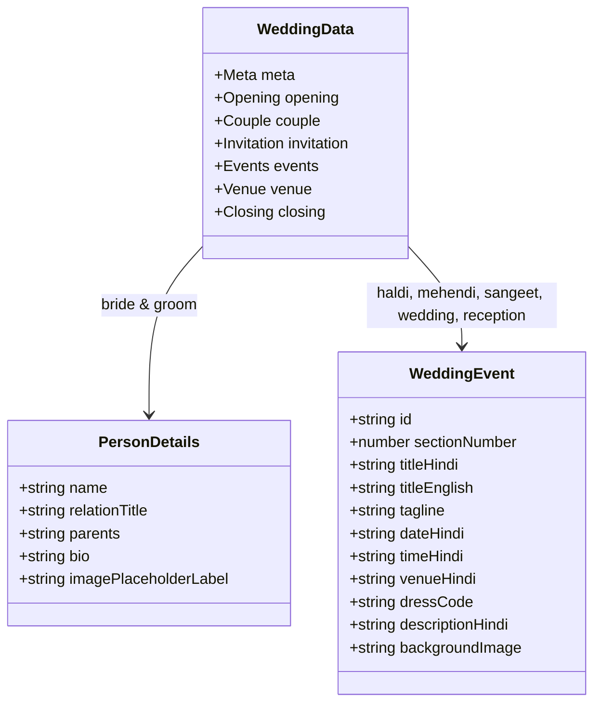

# 🏛️ Architecture & System Design (`ARCHITECTURE.md`)

This document details the architectural choices, engineering constraints, design rules, and data structures of the Hindi Wedding Invitation application.

---

## 1. Technology Stack

| Layer | Tool / Library | Version | Notes & Rules |
|---|---|---|---|
| **Framework** | Next.js (App Router) | `16.4.3` | Uses React Server Components for layout & page shell; `"use client"` for interactive animated sections. |
| **Runtime / UI** | React & React-DOM | `19.3.0` | React 19 compiler compatibility (`babel-plugin-react-compiler`). |
| **Styling** | Tailwind CSS | `^4.0` | Tailwind v4 uses `@import "tailwindcss";` in `globals.css` (no `tailwind.config.js`). |
| **Animations** | Motion for React | `^14.7.1` | **Always import from `"motion/react"`**, never from legacy `"framer-motion"`. |
| **Icons** | Lucide React | `^1.62.0` | Lightweight modern SVG icons (`Heart`, `Calendar`, `Clock`, `MapPin`, `Phone`, etc.). |
| **Utilities** | clsx & tailwind-merge | `^2.1` / `^3.7` | Unified class merging through `cn()` in `lib/utils.ts`. |
| **Typography** | Google Fonts | - | `Noto_Serif_Devanagari` (traditional Hindi serif) + `Poppins` (modern sans-serif). |

---

## 2. Layout & Viewport Containment

### 2.1 Mobile-First Viewport Canvas
The site is built with a **vertical storytelling mobile card concept**:
- Primary target viewport: **390px × 844px** (standard iPhone WhatsApp browser).
- Canvas containment: `max-w-[480px]` centered horizontally (`mx-auto`) on larger screens.
- Outer desktop canvas: `bg-neutral-900` to create a focused luxury card feel.
- Section height: `min-h-[100svh]` (Small Viewport Height) to eliminate mobile address bar jump.

```
+-------------------------------------------------------+
|  Desktop / Tablet Viewport (bg-neutral-900)           |
|                                                       |
|        +-------------------------------------+        |
|        | Fixed Outer Frame (z-50)            |        |
|        | Inverted Solid White Corners        |        |
|        |                                     |        |
|        | Mobile Story Canvas (max-w-[480px]) |        |
|        |  1. Opening Section (100svh)        |        |
|        |  2. Couple Section (100svh)         |        |
|        |  3. Invitation Section (100svh)     |        |
|        |  4. Haldi Section (100svh)          |        |
|        |  5. Mehendi Section (100svh)        |        |
|        |  6. Sangeet Section (100svh)        |        |
|        |  7. Wedding Section (100svh)        |        |
|        |  8. Reception Section (100svh)      |        |
|        |  9. Venue Section (100svh)          |        |
|        | 10. Closing Section (100svh)        |        |
|        |                                     |        |
|        +-------------------------------------+        |
+-------------------------------------------------------+
```

### 2.2 Architectural White Frame & Inverted Corners
In `app/page.tsx` and `app/globals.css`, a fixed architectural border overlays the viewport:
- Fixed container: `pointer-events-none fixed inset-0 sm:left-1/2 sm:-translate-x-1/2 sm:w-[480px] z-50`
- Border strips: Solid white borders along the top, bottom, left, and right (6px mobile, 8px sm+).
- Inverted corner wedges (`.corner-tl`, `.corner-tr`, `.corner-bl`, `.corner-br`): Rendered via pure CSS radial gradients:
  ```css
  .corner-tl {
    background: radial-gradient(circle at 100% 100%, transparent 22px, #ffffff 22.5px);
  }
  ```
- Because it has `pointer-events-none`, user swipes and taps pass directly to underlying buttons and links.

### 2.3 Horizontal Overflow Guard
Because event cards slide in horizontally (`x: 85 -> 0`), parents MUST enforce `overflow-x-hidden` on `main`, `div.canvas`, and `<section>` tags to prevent mobile browsers from triggering horizontal scrolling or page wobble.

---

## 3. Data Architecture (Single Source of Truth)

All dynamic information lives in [`data/wedding.ts`](file:///d:/wedding/data/wedding.ts):



### Key Principles:
1. **Zero Hardcoded Data in Components**: Never hardcode bride/groom names, muhurats, addresses, or phone numbers in JSX. Always import `weddingData` from `@/data/wedding`.
2. **Type Safety**: Strictly typed with TypeScript interfaces (`WeddingData`, `WeddingEvent`, `PersonDetails`).

---

## 4. Animation Engine

Animations are configured in [`lib/animations.ts`](file:///d:/wedding/lib/animations.ts) and orchestrated by [`AnimatedEventSection.tsx`](file:///d:/wedding/components/animation/AnimatedEventSection.tsx).

### 4.1 Easing & Timing Curve
We use a custom cubic-bezier for a high-end editorial feel:
```typescript
export const smoothEase: [number, number, number, number] = [0.22, 1, 0.36, 1];
```

### 4.2 Standard Variants
- **`slideFromRight`**: `x: 90 -> 0`, `opacity: 0 -> 1`.
- **`fadeUp`**: `y: 30 -> 0`, `opacity: 0 -> 1`.
- **`scaleReveal`**: `scale: 0.96 -> 1`, `opacity: 0 -> 1`.
- **`staggerContainer`**: Cascades child animation triggers by `staggerChildren` delay (default: `0.12s`).

### 4.3 Viewport Trigger
Each event section triggers its animation when entering the screen:
```tsx
whileInView="visible"
viewport={{ once: true, amount: 0.2 }}
```
- `once: true`: The animation runs only once as the guest scrolls down, avoiding disruptive re-triggers when scrolling back up.
- `amount: 0.2`: Triggers when 20% of the section is visible in the viewport.

### 4.4 Accessibility (Reduced Motion)
All animation components check `useReducedMotion()`. If a user has `prefers-reduced-motion` enabled in their device, all horizontal offsets collapse to `0`, falling back to gentle opacity fades.

---

## 5. Typography & Hindi Devanagari Guidelines

1. **Heading & Sacred Text Font**: `Noto_Serif_Devanagari` (`--font-serif`, `.font-serif`).
   - Used for shlokas, bride/groom names, ceremony titles, and auspicious greetings.
2. **Body & Numeric Font**: `Poppins` (`--font-sans`, `.font-sans`).
   - Used for dates, times, addresses, phone numbers, and buttons.
3. **Punctuation**:
   - Use the traditional Hindi Purna Viram (`।`) and Deergha Viram (`॥`) for Sanskrit shlokas and Hindi quotes.

