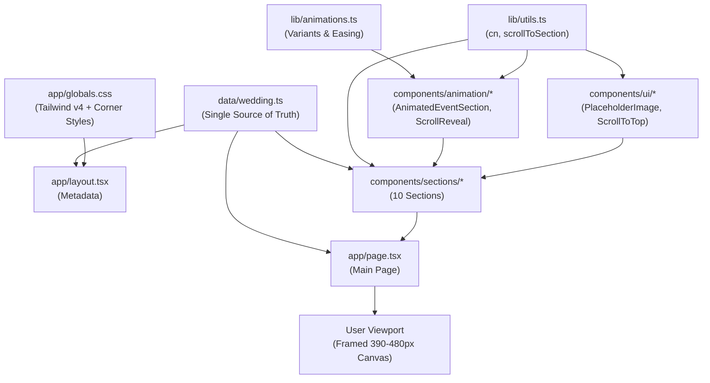

# 📁 Project Folder & File Structure (`folder.md`)

This document is the **fast-lookup architectural map** of the entire codebase. Use this reference whenever you need to locate files, understand responsibilities, check import dependencies, or add new features.

---

## 🌳 Visual Directory Tree

```text
wedding/
├── app/                               # Next.js 16 App Router
│   ├── favicon.ico                    # Browser favicon
│   ├── globals.css                    # Tailwind v4 root styles & custom corner styling
│   ├── layout.tsx                     # Root layout, Google Fonts (Devanagari + Poppins), metadata
│   └── page.tsx                       # Main page mounting all 10 invitation sections + frame overlay
│
├── components/                        # React UI & animation components
│   ├── animation/                     # Reusable Motion animation wrappers
│   │   ├── AnimatedEventSection.tsx   # Viewport-triggered section wrapper (slide from right, stagger)
│   │   ├── ScrollReveal.tsx           # Generic scroll-triggered reveal wrapper (fade/slide/scale)
│   │   └── StaggerContainer.tsx       # Container coordinating staggered animations of child elements
│   │
│   ├── sections/                      # The 10 wedding invitation sections (rendered in vertical order)
│   │   ├── OpeningSection.tsx         # [Section 1] Hero landing screen, background image & CTA
│   │   ├── CoupleSection.tsx          # [Section 2] Bride & Groom portraits, family lineage, quote
│   │   ├── InvitationSection.tsx      # [Section 3] Ganesh shloka, formal Hindi invite & host families
│   │   ├── HaldiSection.tsx           # [Section 4] Haldi ceremony details & imagery
│   │   ├── MehendiSection.tsx         # [Section 5] Mehendi celebration details & imagery
│   │   ├── SangeetSection.tsx         # [Section 6] Sangeet dance night details & imagery
│   │   ├── WeddingSection.tsx         # [Section 7] Sacred wedding rituals (पाणिग्रहण / फेरे)
│   │   ├── ReceptionSection.tsx       # [Section 8] Reception dinner (प्रीतिभोज) details
│   │   ├── VenueSection.tsx           # [Section 9] Location address, Google Maps button & parking
│   │   └── ClosingSection.tsx         # [Section 10] Gratitude note, family contacts & scroll-to-top
│   │
│   └── ui/                            # Shared UI primitives
│       ├── Decoration.tsx             # Zeenat falling petals ambient decoration overlay
│       ├── PlaceholderImage.tsx       # Illustrated visual placeholder with badges & aspect ratios
│       ├── ScrollToTop.tsx            # Floating / inline smooth scroll-to-top button
│       └── SectionContainer.tsx       # Standard section layout wrapper with mobile constraint
│
├── data/                              # Centralized configuration & data layer
│   └── wedding.ts                     # ⭐ SINGLE SOURCE OF TRUTH (all names, dates, copy & links)
│
├── lib/                               # Utilities & animation configurations
│   ├── animations.ts                  # Reusable Motion variants (fadeUp, slideFromRight, easings)
│   └── utils.ts                       # Class merging (`cn()`) and smooth scrolling helpers
│
├── public/                            # Static public assets
│   ├── illustrations/                 # Wedding SVG/PNG art (Ganesh, kalash, dholak, haldi pot)
│   │   └── README.md                  # Asset naming guide for illustrations
│   └── images/                        # High-resolution photos & section backgrounds
│       ├── homebg.png                 # Opening hero background image
│       ├── haldi.jpg                  # Haldi section artwork/photo
│       ├── sangeet.png                # Sangeet section artwork/photo
│       └── README.md                  # Photo dimensions & optimization guide
│
├── AGENTS.md                          # AI Agent instructions & system rules
├── ARCHITECTURE.md                    # System architecture, design decisions & rendering specs
├── eslint.config.mjs                  # ESLint flat config
├── folder.md                          # (This file) Complete directory & file structure map
├── next.config.ts                     # Next.js configuration
├── package.json                       # Dependencies & scripts
├── QUICK_START.md                     # Cheatsheet for developers & agents
├── README.md                          # Project overview & mobile invitation showcase
└── tsconfig.json                      # TypeScript compiler configuration
```

---

## 📑 Detailed Breakdown by Directory

### 1. `app/` (Application Router & Global Shell)

| File | Purpose | Key Exports / Elements |
|---|---|---|
| [`app/layout.tsx`](file:///d:/wedding/app/layout.tsx) | HTML root layout; sets lang=`"hi"`, loads `Noto_Serif_Devanagari` (`--font-serif`) and `Poppins` (`--font-sans`), binds metadata & viewport. | `RootLayout`, `metadata`, `viewport` |
| [`app/page.tsx`](file:///d:/wedding/app/page.tsx) | Main single-page invitation assembling Sections 1 to 10 in a responsive `max-w-[480px]` container, overlaid with the fixed architectural white frame. | `WeddingInvitationPage` |
| [`app/globals.css`](file:///d:/wedding/app/globals.css) | Imports Tailwind v4 via `@import "tailwindcss";`, defines CSS font variables, horizontal overflow guards, and radial-gradient corner classes (`.corner-tl`, `.corner-tr`, `.corner-bl`, `.corner-br`). | Global utility classes |

---

### 2. `data/` (Single Source of Truth)

| File | Purpose | Key Exports |
|---|---|---|
| [`data/wedding.ts`](file:///d:/wedding/data/wedding.ts) | Centralized state store for all wedding data: couple names, parents, bios, shlokas, Hindi copy, event timings, venues, Google Maps URL, and contact numbers. | `weddingData`, `WeddingData`, `WeddingEvent`, `PersonDetails` |

> [!IMPORTANT]
> **Always edit `data/wedding.ts` first** to change texts, names, dates, or image paths. Component templates consume this object directly.

---

### 3. `components/sections/` (10 Invitation Sections)

Sections are mounted sequentially in [`app/page.tsx`](file:///d:/wedding/app/page.tsx):

| # | Component | Visual Role & Content |
|---|---|---|
| 1 | [`OpeningSection.tsx`](file:///d:/wedding/components/sections/OpeningSection.tsx) | Hero entrance screen with background artwork (`homebg.png`), auspicious symbol, couple headline, and "आमंत्रण खोलें" button. |
| 2 | [`CoupleSection.tsx`](file:///d:/wedding/components/sections/CoupleSection.tsx) | Bride & Groom portraits, names, family details, and Hindi romantic quote. |
| 3 | [`InvitationSection.tsx`](file:///d:/wedding/components/sections/InvitationSection.tsx) | Lord Ganesha shloka (वक्रतुण्ड महाकाय...), formal Hindi invitation letter, and inviting families. |
| 4 | [`HaldiSection.tsx`](file:///d:/wedding/components/sections/HaldiSection.tsx) | Haldi ceremony event card (date, time, venue, dress code, background). |
| 5 | [`MehendiSection.tsx`](file:///d:/wedding/components/sections/MehendiSection.tsx) | Mehendi celebration event card and artwork. |
| 6 | [`SangeetSection.tsx`](file:///d:/wedding/components/sections/SangeetSection.tsx) | Musical night and dance party event card. |
| 7 | [`WeddingSection.tsx`](file:///d:/wedding/components/sections/WeddingSection.tsx) | Sacred wedding ritual (पाणिग्रहण संस्कार / शुभ विवाह), muhurat, and mandap. |
| 8 | [`ReceptionSection.tsx`](file:///d:/wedding/components/sections/ReceptionSection.tsx) | Post-wedding reception dinner (प्रीतिभोज) details. |
| 9 | [`VenueSection.tsx`](file:///d:/wedding/components/sections/VenueSection.tsx) | Venue address, parking information, and interactive Google Maps pin link button (`मानचित्र पर देखें`). |
| 10 | [`ClosingSection.tsx`](file:///d:/wedding/components/sections/ClosingSection.tsx) | Gratitude message (सधन्यवाद), family contact telephone links, and scroll-to-top button. |

---

### 4. `components/animation/` (Motion & Interactions)

| File | Purpose | How It Works |
|---|---|---|
| [`AnimatedEventSection.tsx`](file:///d:/wedding/components/animation/AnimatedEventSection.tsx) | Standard wrapper for ceremony sections. | Animates in from the right (`x: 85 -> 0`), fades from 0 to 1 with cubic-bezier easing, staggers children, and honors `useReducedMotion()`. |
| [`ScrollReveal.tsx`](file:///d:/wedding/components/animation/ScrollReveal.tsx) | Viewport trigger wrapper for individual elements. | Supports `fadeUp`, `slideLeft`, `slideRight`, `scale` when reaching threshold. |
| [`StaggerContainer.tsx`](file:///d:/wedding/components/animation/StaggerContainer.tsx) | Parent container that coordinates sequential child animations. | Sets `staggerChildren` delay for smooth cascading reveals. |

---

### 5. `components/ui/` (Shared Primitives)

| File | Purpose |
|---|---|
| [`Decoration.tsx`](file:///d:/wedding/components/ui/Decoration.tsx) | Zeenat ambient falling rose petals decoration overlay rendered globally across the website. |
| [`PlaceholderImage.tsx`](file:///d:/wedding/components/ui/PlaceholderImage.tsx) | Shows placeholder cards with aspect ratios (`portrait`, `banner`, `hero`, etc.) and Lucide icons before real photos are uploaded. |
| [`ScrollToTop.tsx`](file:///d:/wedding/components/ui/ScrollToTop.tsx) | Button invoking `scrollToTop()` from `lib/utils.ts`. |
| [`SectionContainer.tsx`](file:///d:/wedding/components/ui/SectionContainer.tsx) | Responsive flex container enforcing `min-h-[100svh]` and `max-w-[430px]` content boundaries. |

---

### 6. `lib/` (Core Utilities & Animation Configs)

| File | Exports | Purpose |
|---|---|---|
| [`lib/animations.ts`](file:///d:/wedding/lib/animations.ts) | `smoothEase`, `fadeUp`, `slideFromRight`, `slideFromLeft`, `scaleReveal`, `reducedMotionVariants` | Centralized Motion animation parameters, bezier curves, and accessibility fallbacks. |
| [`lib/utils.ts`](file:///d:/wedding/lib/utils.ts) | `cn()`, `scrollToSection()`, `scrollToTop()` | Merges Tailwind class strings with `clsx` + `tailwind-merge`; handles smooth browser scrolling. |

---

### 7. `public/` (Static Assets)

| Directory | Content & Usage |
|---|---|
| `public/images/` | High-resolution photography (`bride.jpg`, `groom.jpg`, `homebg.png`, `haldi.jpg`, `sangeet.png`). |
| `public/illustrations/` | Traditional Indian wedding artwork (kalash, ganesh, dholak, mandap, mehndi hands). |

---

## 🔄 Dependency & Data Flow Map



---

## 🎯 Quick "Where Do I Add / Edit..." Guide

| Task | File to Touch |
|---|---|
| Change bride / groom / parent names | [`data/wedding.ts`](file:///d:/wedding/data/wedding.ts) (`weddingData.couple`) |
| Change ceremony dates or times | [`data/wedding.ts`](file:///d:/wedding/data/wedding.ts) (`weddingData.events.*`) |
| Update Google Maps link | [`data/wedding.ts`](file:///d:/wedding/data/wedding.ts) (`weddingData.venue.mapUrl`) |
| Add new ceremony (e.g., Tilak) | 1. Add entry in `data/wedding.ts`<br/>2. Create component in `components/sections/`<br/>3. Mount in `app/page.tsx` |
| Change animation speed / distance | [`lib/animations.ts`](file:///d:/wedding/lib/animations.ts) or props on `AnimatedEventSection` |
| Replace placeholder with real photo | Drop image into `public/images/` and update `backgroundImage` in `data/wedding.ts` |
| Adjust the outer frame or corner curves | [`app/globals.css`](file:///d:/wedding/app/globals.css) (`.corner-tl`, etc.) and [`app/page.tsx`](file:///d:/wedding/app/page.tsx) |

